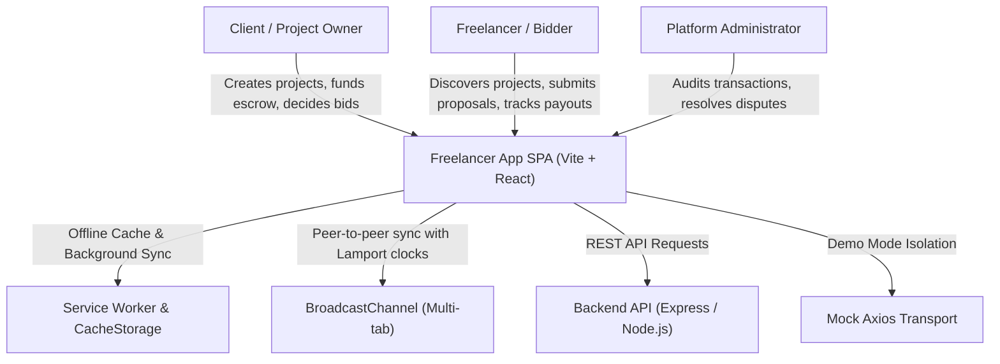
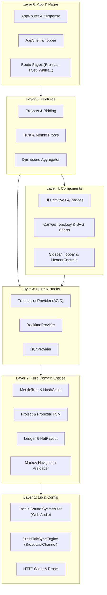
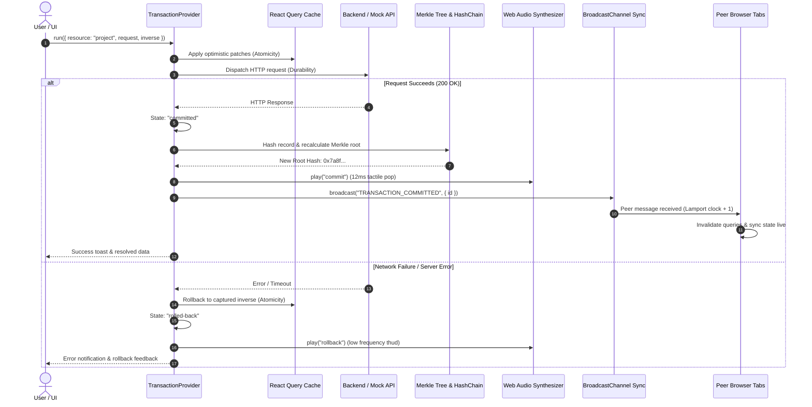

# Architecture

This document explains how the frontend is put together, why it is split the
way it is, and where each kind of logic belongs. It is written for the next
person who has to change something.

---

## 1. Layering

```
┌──────────────────────────────────────────────────────────────────────┐
│ app/            composition roots: router, providers, guards,        │
│                 ErrorBoundary, the authenticated shell               │
│ pages/          route components — compose features, own the URL      │
├──────────────────────────────────────────────────────────────────────┤
│ features/       vertical slices: UI + hooks + mutations per capability│
├──────────────────────────────────────────────────────────────────────┤
│ components/     design system: ui/, form/, charts/, layout/, feedback │
│ store/          cross-cutting providers (i18n, theme, command,        │
│                 notifications, ACID transactions, realtime)          │
│ hooks/          reusable, dependency-free hooks                      │
├──────────────────────────────────────────────────────────────────────┤
│ entities/       pure domain logic, no React, no I/O                   │
│ services/       one module per API resource, typed responses          │
│ mocks/          demo transport + seed (the only peer of services)     │
├──────────────────────────────────────────────────────────────────────┤
│ config/         env, constants, navigation model, query-key factory   │
│ lib/            http, formatters, validators, storage, export, events │
├──────────────────────────────────────────────────────────────────────┤
│ types/          shared contracts (wire format + derived entities)     │
└──────────────────────────────────────────────────────────────────────┘
```

### The dependency rule

Imports only point **downwards**:

- `app` | `pages` → `features` → `components` | `store` | `hooks`
  → `entities` | `services` | `mocks` → `config` | `lib` → `types`
- `lib` and `entities` **never** import React. That is what lets the whole
  domain and formatting layer be unit-tested without a DOM, and reused from
  stores, CSV exporters and the demo transport.
- `features` never import each other's internals. When two features must talk
  (a proposal change must refresh the project view) they go through the
  **query-key factory** ([`src/config/queryKeys.ts`](../src/config/queryKeys.ts))
  or the **event bus** ([`src/lib/eventBus.ts`](../src/lib/eventBus.ts)) — never
  through a direct import, which is how import cycles start.
- `config` is data: navigation entries carry an `IconName` key rather than a
  React element, so configuration never reaches into `components/`.
- The HTTP client (`@/lib/http`) is a `services/` concern; `lib/http/errors`
  (the error shape) is usable anywhere.

### The rule is enforced, not just written

[`src/test/architecture.test.ts`](../src/test/architecture.test.ts) reads every
source file and fails the build when the import graph stops matching this
section:

| # | Rule |
| --- | --- | 
| 1 | imports never reach a layer above their own | 
| 2 | `lib/**` and `entities/**` import no React, no UI, no state container | 
| 3 | features do not import other features (except the `dashboard` aggregator); `components/` imports neither `features/` nor `pages/` | 
| 4 | the HTTP client is imported only by `services/`, its own transport and the entry point | 
| 5 | cross-folder imports use the `@/` alias | 
| 6 | every `@/` import resolves to a real file | 
| 7 | the import graph is acyclic (type-only edges excluded) | 

Two exceptions are **declared in the test**, where they can be read and
questioned rather than rediscovered:

- `features/dashboard/` is the read-model aggregator — it may compose other
  features into one screen; nothing else may reach sideways (pages compose
  features instead, e.g. `TrustPage` injects the proposal decision into
  `RiskQueue`).
- `app/shell/AppShell.tsx` lives above `features/` because it *is* an
  application composition root; the presentational `components/` layer below it
  stays feature-free.

### Why feature folders instead of type folders

`features/proposals/` contains the board, the table, the form, the price
simulator, the mutation hooks and the query hooks that touch proposals. Changing
bidding means opening one folder instead of six. Shared *presentational* pieces
are promoted to `components/` only when a second feature needs them
(`Button`, `DataTable`, `Modal`, charts…).

---

## 2. State ownership

There is exactly one owner per kind of state. Mixing them is what produces
"the list and the badge disagree" bugs.

| Kind of state | Owner | Example |
| --- | --- | --- |
| Server state | TanStack Query, keyed by `queryKeys` | projects, proposals, users, ledger |
| Derived server state | `entities/*` selectors, memoised in features | dashboards, analytics, matches, trust |
| URL state | React Router + `useQueryParams` | filters, sort, page, tab |
| Session state | Query cache (`auth.profile`) + route guards | current user, role |
| Cross-cutting UI | `store/*` providers | locale, theme, palette, toasts |
| Pending writes | `store/transaction` journal | optimistic patches and their inverses |
| Cross-domain projections | `entities/activity` (pure) | audit feed, per-write impact map |
| Durable prefs | `lib/storage` (namespaced) | last locale, theme, journal |

Nothing duplicates server data into component state; `useState` is reserved for
things that genuinely only exist in the browser (open modals, draft inputs,
hovered rows).

### Query keys as an API

Every cache key is declared once in `config/queryKeys.ts` and is hierarchical:

```ts
queryKeys.projects.all          // ["projects"]
queryKeys.projects.list(filters) // ["projects","list",{…}]
```

That lets one mutation invalidate a whole domain —
`invalidateQueries({ queryKey: queryKeys.projects.all })` refreshes lists,
details, dashboards and analytics together — and makes cache bugs greppable.

---

## 3. Data flow

```
component ──useQuery──► services ──http.get──► axios instance ──► /api (live)
     │                                             │
     │                                             └──► mock adapter (demo)
     │
     └──useMutation──► transaction.run() ──► optimistic patches ──► cache
                              │                     │
                              │                     └─ inverse captured
                              └── request ──► commit | rollback | queue
```

1. **Read** — `useQuery` calls a service, which calls `http.get<T>()`. The
   client unwraps the API envelope (`{ statusCode, data }`), normalises errors
   into `ApiError`, retries with backoff (never on auth/permission failures),
   and performs **single-flight token refresh** on the first 401.
2. **Write** — components never call `http` directly for mutations. They call
   `useTransactions().run(...)`, which applies optimistic patches, sends the
   request, and either invalidates, rolls back, or queues the change. See
   [ACID.md](ACID.md).
3. **Derive** — dashboards, analytics, matches, trust and the ledger are pure
   functions over the data already in the cache (`entities/*`). No analytics
   endpoint, no third-party tracker.

### The mock transport

`VITE_API_MODE=mock` installs an axios **adapter** (`src/mocks/adapter.ts`) on
the same client instance. Services, hooks and components are untouched: the
adapter answers routes with the same paths, envelope, status codes and
authorization rules as Express, backed by a seeded dataset persisted to
`localStorage`. Installation is asynchronous (the dataset is a dynamic import so
it stays out of the production bundle), so `main.tsx` awaits
`mockTransportReady` before the first render — that removes the whole class of
"first request beat the demo database" races.

The *wiring* is deliberately not in `lib/http`: `lib` must not depend on
`mocks`, so `lib/http` only exposes `installTransport(adapter)` and the
composition happens in [`src/mocks/install.ts`](../src/mocks/install.ts), the
one file allowed to know both sides (see [DECISIONS.md](DECISIONS.md) #4).

### One write, every domain

A write is never *only* the resource it names: accepting a bid also moves money,
changes trust and XP, raises a notification and lands in the audit trail. Those
fan-outs are declared once as data in
[`src/entities/activity/impact.ts`](../src/entities/activity/impact.ts), tested,
and rendered in the inspector and the audit page. The full map is
[CROSS_DOMAIN.md](CROSS_DOMAIN.md).

---

## 4. Provider composition

`app/providers/AppProviders.tsx` mounts the cross-cutting providers in a
deliberate order, documented in the file:

| Order | Provider | Why here |
| --- | --- | --- |
| 1 | `ThemeProvider` | writes CSS tokens before anything paints |
| 2 | `I18nProvider` | sets `<html lang dir>` and the module-level locale used by `Intl` formatters |
| 3 | `QueryClientProvider` | the cache every feature reads (client created lazily in state so StrictMode/HMR cannot share an instance) |
| 4 | `CommandProvider` | registry the palette and hotkeys publish into |
| 5 | `NotificationProvider` | notification centre fed by derived events |
| 6 | `TransactionProvider` | ACID pipeline — needs the cache and translations |
| 7 | `RealtimeProvider` | background revalidation — needs the cache |
| 8 | `ErrorBoundary` | catches render errors below the providers so a crash keeps routing alive |

---

## 5. Routing

`app/router/AppRouter.tsx`:

- **Every page is lazy.** The landing page arrives without dashboards, charts or
  the Kanban board. `Suspense` renders `PageLoader`.
- **Nested shells.** `PublicShell` and `AppShell` stay mounted across
  navigations, so the sidebar and topbar do not flicker or lose state.
- **Three role areas** (`/owner`, `/freelancer`, `/admin`) share the same pages
  where the capability is identical (`DashboardPage`, `ProjectsPage`,
  `MessagesPage`, …) and differ where it is not.
- **Navigation is data** (`config/navigation.tsx`), so the sidebar, mobile
  drawer, breadcrumbs and command palette cannot disagree about what exists.
- **A guard with three outcomes** (`app/guards/ProtectedRoute.tsx`): no session
  → `/auth` (remembering the intended URL), unverified session →
  `/pending-approval`, wrong role → `/not-authorized`.
- **`NavigationAnnouncer`** moves focus/scroll and updates a polite live region
  on every route change — SPA navigations are otherwise invisible to screen
  readers.

---

## 6. Rendering and performance

- **Code splitting per route**, plus manual vendor chunks (`react`, `router`,
  `query`, `icons`) so app code deploys without re-downloading vendors.
- **Memoised derivations.** Expensive aggregates (`buildAnalyticsSnapshot`,
  `buildOwnerPortfolio`, `rankProjectsForUser`) run inside `useMemo` keyed on
  the data they consume.
- **Windowed tables.** `useVirtualList` keeps long admin lists at roughly one
  screenful of DOM nodes; it is ~50 lines with no dependency.
- **Skeletons instead of spinners** for layout-stable loading states
  (`SkeletonStatGrid`, `DataTable` skeleton rows).
- **Debounced inputs** (`useDebouncedValue`) keep search-as-you-type from
  hammering the API.
- **Zero-dependency charts.** `components/charts/*` renders SVG directly
  (`AreaChart`, `BarChart`, `DonutChart`, `Sparkline`) — accessible, themeable
  with CSS variables, and no charting runtime in the bundle.
- **Responsive by default.** The layout is CSS-grid based with drawer
  navigation below `lg`; charts and stat grids reflow without JS.

---

## 7. Design system

`components/ui` is the vocabulary: `Button`, `Badge`, `Card`, `Modal` (focus
trap, `Esc`, scroll lock, `aria-modal`), `DataTable` (sortable, virtualisable,
empty/loading/error states), `Pagination`, `Tabs` (roving tabindex), `Tooltip`,
`Progress`, `StatCard`, `Timeline`, `EmptyState`, `Callout`, `Skeleton`,
`Avatar`.

`components/form` wraps the input primitives used with React Hook Form:
`TextField`, `Select`, `RadioGroup`, `Toggle`, `TagInput`, `DatePickerField`,
`SearchInput`, `FormField`. They carry label/`aria-describedby`/error wiring once,
so no form re-implements validation messaging.

Design tokens live in `src/index.css` as CSS custom properties
(`--color-surface`, `--color-ink`, `--color-line`, …) consumed through Tailwind.
Dark mode therefore works by swapping variables, not by maintaining two class
sets.

---

## 8. Internationalisation

`store/i18n` holds ~1 000 keys in `fa` and `en`.

- `I18nProvider` is the only writer of the module-level locale in
  `lib/locale.ts`; `t()` interpolates `{placeholders}` and falls back to the key.
- `Intl` does the heavy lifting: `fa-IR` renders the **Jalali** calendar and
  Persian digits; `en-GB` renders Gregorian dates and Latin digits.
- Number input accepts Persian/Arabic digits, grouping separators and the
  Persian decimal mark (`parseNumeric`), so forms work with a Persian keyboard.
- Search normalises Arabic letter forms, diacritics and ZWNJ
  (`normalizeSearch`), so "یک" matches "يك".
- `dir` is applied to `<html>`; layout uses logical properties/CSS handles the
  mirroring.

---

## 9. Error handling and resilience

- **One error shape** (`ApiError`) with a `kind` (network, timeout, unauthorized,
  forbidden, not-found, validation, server, unknown) produced by
  `normalizeError`. Components never touch `error.response.data`.
- **Error boundaries** wrap each route subtree, and a top-level one keeps the
  shell alive.
- **Offline awareness**: the client emits `networkOffline`/`networkOnline`; an
  `OfflineBanner` appears and queued transactions **replay the original
  request** when connectivity returns, and again on the next load — the journal
  stores a serialisable command for that (see [ACID.md](ACID.md) §2). Entries a
  newer build cannot re-send are quarantined with a visible reason instead of
  being dropped.
- **Single-flight refresh**: concurrent 401s trigger one `/user/refresh-token`
  call and are replayed after it succeeds; auth-free endpoints never loop.
- **Fail-safe storage**: `lib/storage` guards against Safari private mode and
  quota errors, falling back to an in-memory map.

---

## 10. Testing

Vitest + Testing Library, with `src/test/setup.ts` (jsdom gaps), typed factories
in `src/test/factories.ts`, and behaviour-level tests for the ACID pipeline and
the demo transport contract.

Three **conformance suites** keep this document honest:

| Suite | Asserts |
| --- | --- |
| `src/test/architecture.test.ts` | §1's dependency rule (7 rules, incl. acyclic) |
| `src/test/i18n.test.ts` | every statically written translation key resolves |
| `src/test/docs.test.ts` | every relative link in the Markdown tree resolves |

Details and conventions: [TESTING.md](TESTING.md).

---

## 11. Where to put new code

| You are adding… | Put it in… |
| --- | --- |
| A new screen | `pages/`, lazy route in `AppRouter`, entry in `config/navigation.ts` |
| A capability used by one role | `features/<capability>/` |
| A calculation over domain data | `entities/<domain>/`, pure and unit-tested |
| A cross-domain coupling ("accepting a bid moves money") | `entities/activity/impact.ts` + a test — see [CROSS_DOMAIN.md](CROSS_DOMAIN.md) |
| An API resource | `services/<resource>.ts` + keys in `config/queryKeys.ts` + a route in `mocks/adapter.ts` |
| A new mutation | `useTransactions().run(...)` with a `command` — never raw `http` in a component |
| A write that must survive a reload | register it in `store/transaction/commands.ts` |
| A nav entry | `config/navigation.ts` (label key + `IconName`) |
| A reusable visual primitive | `components/ui` (add to `index.ts`) |
| A new string | `store/i18n/translations.ts` for **both** locales |
| A document | `docs/*.md`, linked from README (the link suite enforces it) |

---

## 12. Plugin system

To allow extensions, observability hooks, and external partner integrations without
polluting the core feature slices, FreelanceHub includes an extensible plugin
architecture.

### How the plugin registry works

The plugin registry is a lightweight registry located in the `lib` layer. It
maintains an isolated, ordered list of registered plugins and coordinates lifecycle
events. The registry holds no React dependencies, keeping it fully testable in pure
Node/jsdom environments and preserving the architectural layer rule (Rule 2).

```ts
interface PluginContext {
  locale: string;
  theme: "light" | "dark";
  userRole?: "CLIENT" | "FREELANCER" | "ADMIN";
  emitEvent: (event: string, payload: unknown) => void;
}

interface Plugin {
  id: string;
  name: string;
  version: string;
  onInit?: (context: PluginContext) => void | Promise<void>;
  onTransaction?: (event: TransactionEvent) => void;
  onNavigate?: (path: string) => void;
  onDestroy?: () => void;
}
```

### Lifecycle hooks

1. **`onInit(context)`**: Invoked once during application bootstrap after the
   core providers are mounted. Receives environment metadata and the global event emitter.
2. **`onTransaction(event)`**: Fired whenever a transaction transitions through
   the ACID pipeline (`committed`, `rolled-back`, or `queued`). Allows telemetry
   and external audit plugins to react without modifying `TransactionProvider`.
3. **`onNavigate(path)`**: Triggered on SPA route changes by `NavigationAnnouncer`.
   Enables analytics tracking or external breadcrumb integrations.
4. **`onDestroy()`**: Called during application unmount or plugin de-registration
   for clean teardown of timers, sockets, or listeners.

### How to create a plugin

Create an implementation conforming to the `Plugin` contract:

```ts
// src/plugins/auditLoggerPlugin.ts
export const auditLoggerPlugin: Plugin = {
  id: "telemetry-audit-logger",
  name: "Telemetry Audit Logger",
  version: "1.0.0",
  onInit(ctx) {
    console.info(`[Plugin] Initialized with locale: ${ctx.locale}`);
  },
  onTransaction(event) {
    if (event.state === "committed") {
      // dispatch telemetry payload to remote logging collector
    }
  },
  onDestroy() {
    // cleanup resources
  },
};
```

### Plugin discovery and registration

Plugins are registered during application bootstrapping in `src/app/providers/AppProviders.tsx`
or selectively conditioned on feature flags. The registry guarantees deterministic execution
order and error isolation (a failing plugin hook never halts the core application pipeline).

---

## 13. Service container & Dependency Injection

To decouple UI features from concrete network implementations and streamline
unit and integration testing, services are bound through a service container pattern.

### How DI works in the app

Rather than importing concrete singleton instances across hundreds of components,
features consume services through a centralized registry contract:

```ts
export interface ServiceRegistry {
  auth: AuthService;
  projects: ProjectService;
  proposals: ProposalService;
  categories: CategoryService;
  users: UserService;
}
```

Modules obtain services via `getService("projects")` or the React hook
`useService("projects")`. The container provides default singleton bindings backed
by `@/lib/http`.

### How to swap services for testing

In test environments (such as Vitest integration tests or storybook mock harnesses),
services can be dynamically substituted without mocking module imports:

```ts
import { registerService, resetServices } from "@/services/container";

beforeEach(() => {
  resetServices();
  registerService("projects", mockProjectService);
});
```

This guarantees test isolation, eliminates fragile `vi.mock()` hoisting issues,
and allows simulating slow networks, server faults, or edge-case response payloads
deterministically.

### Default service registry

At application runtime, `services/index.ts` automatically registers standard HTTP
services configured with the base client, retry policies, and auth interceptors.
In demo mode (`VITE_API_MODE=mock`), the same services run transparently on top of
the axios adapter without altering container bindings.

---

## 14. Feature flags

Feature flags allow decoupled releases, gradual canary rollouts, A/B testing, and
safe trunk-based development.

### How flags are defined

Feature flags are declared in `src/config/features.ts` as a strongly typed
configuration record:

```ts
export interface FeatureFlags {
  dndKanban: boolean;
  aiRecommendations: boolean;
  activityHeatmap: boolean;
  webVitalsTelemetry: boolean;
  advancedPwa: boolean;
  pluginSystem: boolean;
}
```

### How to add a new flag

1. **Add the flag key** to the `FeatureFlags` interface in `src/config/features.ts`.
2. **Assign the default state** in `DEFAULT_FEATURE_FLAGS`.
3. **Use the hook** in components or routes:
   ```tsx
   import { useFeatureFlag } from "@/hooks/useFeatureFlag";

   export function ProposalView() {
     const hasKanban = useFeatureFlag("dndKanban");
     return hasKanban ? <ProposalBoard /> : <ProposalsTable />;
   }
   ```

### Runtime vs build-time flags

- **Build-time flags**: Configured via Vite environment variables (e.g.
  `VITE_FF_AI_RECOMMENDATIONS=true`). Code paths gated behind build-time flags can
  be eliminated via tree-shaking and dead code elimination in production builds.
- **Runtime flags**: Evaluated dynamically based on user role, URL query params
  (`?ff=dndKanban:1`), or browser storage overrides (`localStorage.getItem("ff:...")`).
  Runtime flags enable immediate feature toggling during live demos and manual QA
  without rebuilding or redeploying the static frontend bundle.

---

## 15. Architectural models & diagrams (C4 & Sequence)

### 15.1 C4 System Context diagram

The system context diagram shows the actors, the single-page application boundary, and external systems:



### 15.2 C4 Container & Layer Architecture



### 15.3 Cryptographically Verifiable ACID Commit & Cross-Tab Replication

The following sequence illustrates the end-to-end lifecycle of a client mutation, from optimistic cache update through cryptographic Merkle tree commitment, acoustic feedback, and peer tab synchronization:




